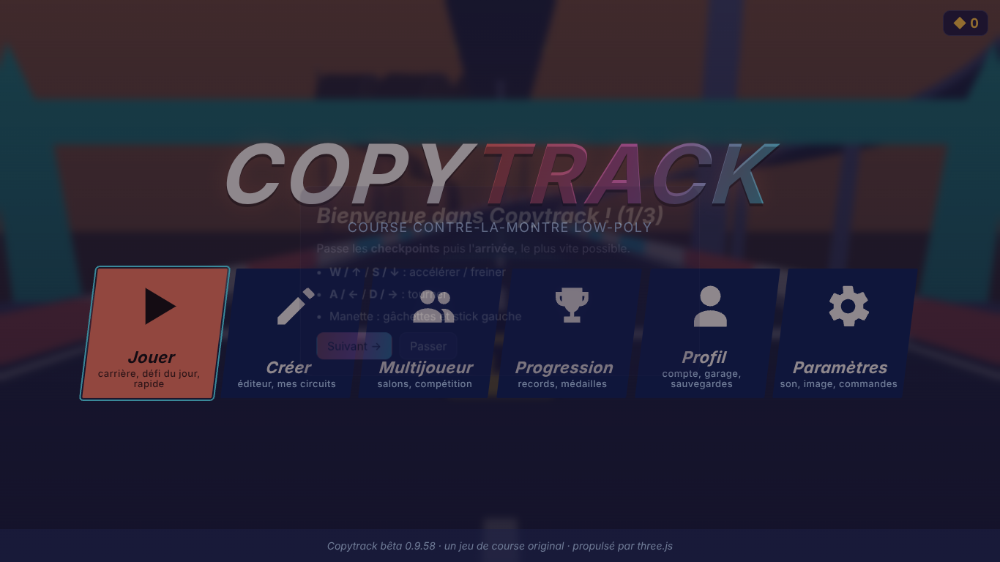
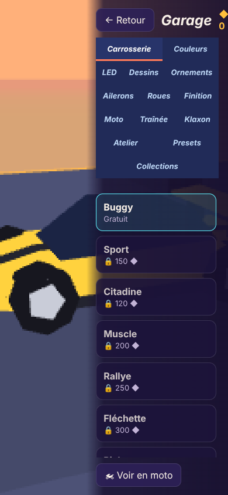
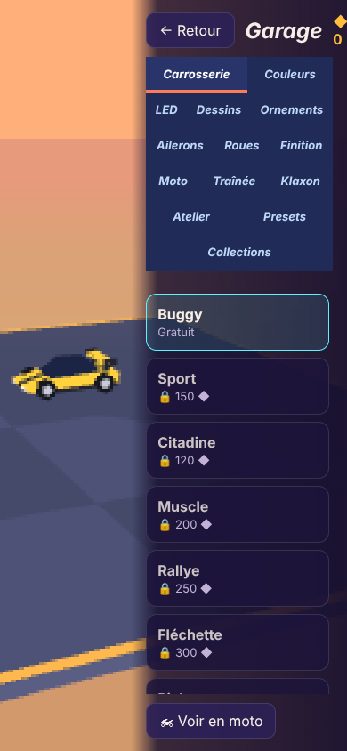
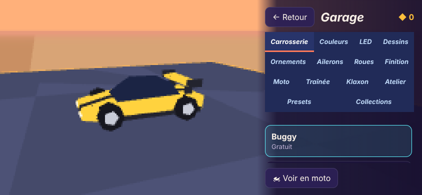
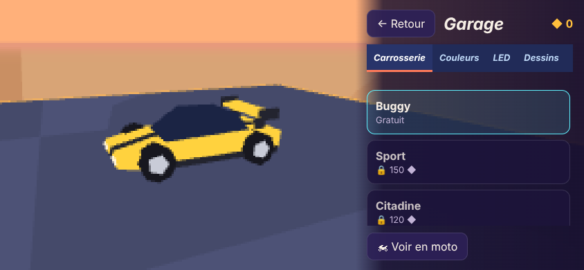
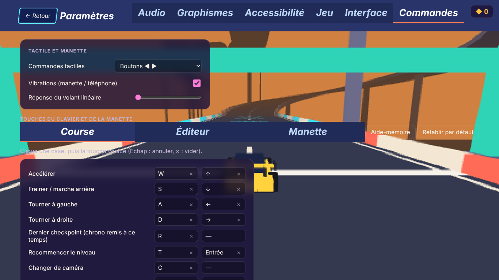
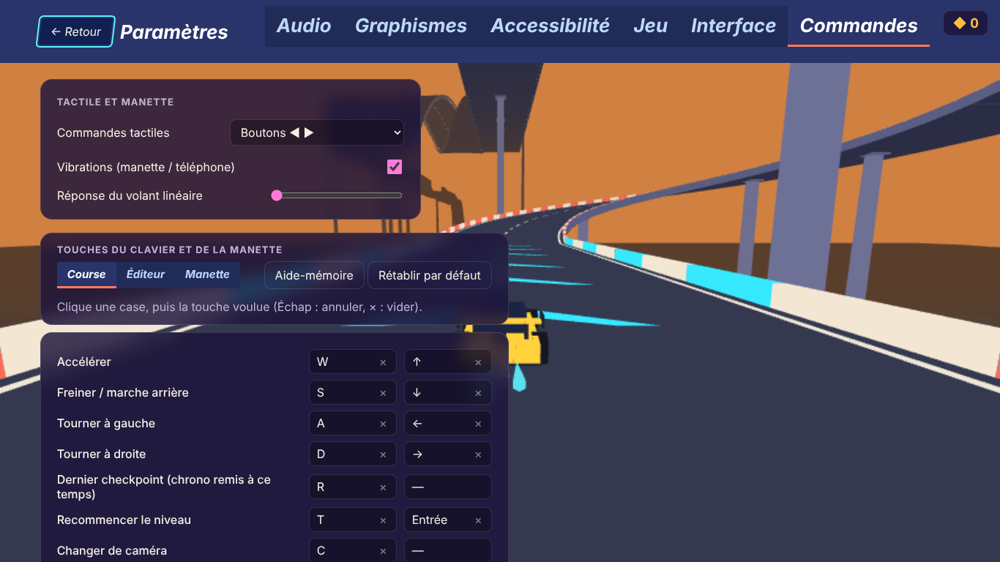
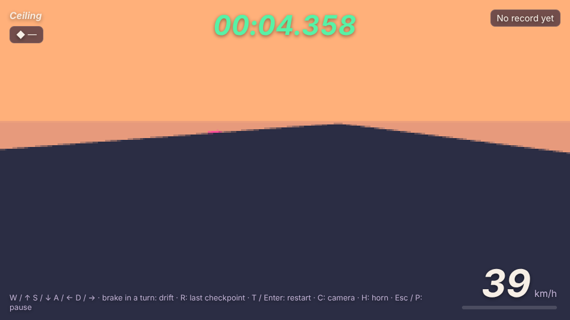
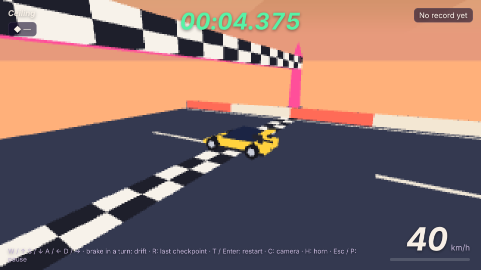

# Audit complet de Copytrack — version 0.9.59 (10 et 11 novembre 2026)

Ce rapport dit **ce qui a été réellement fait**, ce qui a été trouvé, ce qui a été corrigé, et — sans rien cacher — ce qui ne l'a pas été ou n'a pas pu être testé.
Quatre statuts sont utilisés : **BUG CONFIRMÉ** (reproduit, avec un test qui échoue avant la correction), **BUG PROBABLE**, **RISQUE**, **AMÉLIORATION**.
Une absence de bug détecté n'est pas une absence de bug.

> **À lire avant de fusionner.** Le dernier commit de la branche change la physique (`PHYS_VER` 33 → **34**). Il est isolé pour pouvoir être retiré
> (`git revert`) si tu ne veux pas de ce changement maintenant. Si tu le gardes : après la mise en ligne du jeu, **redéployer `submit-score`**
> (`npm run build:function`, puis coller `supabase/functions/submit-score/index.ts`) ; d'ici là le serveur refuse les nouveaux temps avec un message clair, et les
> records restent sur l'appareil. Coût mesuré sur la production : **2 temps** seulement sont en version 33 (sur 189). Rien n'a été déployé ni migré par cet audit.

## A. État général

### Architecture comprise

Site statique sans compilation (HTML + modules ES, three.js embarqué), plus Supabase (PostgREST, Auth, deux fonctions Edge). Le cœur est un **noyau de simulation
déterministe** (pas fixe de 1/120 s, mathématiques maison `js/dmath.js`) exécuté à l'identique par le navigateur (course, fantômes), Deno (vérification des temps par
rejeu) et Node (outils, tests). `PHYS_VER` lie records, replays, fantômes, classements et salons. Les grosses classes sont découpées en familles de méthodes
(`js/physics/`, `js/race/`, `js/editor/`, `js/app/`…). Détail : [ARCHITECTURE.md](ARCHITECTURE.md), [MODULES.md](MODULES.md).

### Systèmes inspectés et profondeur de l'inspection

| Système | Lecture du code | Exécution réelle |
|---|---|---|
| Physique, collisions, rubans, obstacles, revêtements (`physics.js`, `physics/*`, `obstacles.js`, `pieces.js`, `ribbons.js`, `track/surfaces.js`) | intégrale | exploration aléatoire (voir D), sondes ciblées |
| Règles de course, simulation, replays, fantômes (`simulation.js`, `raceLogic.js`, `replay.js`, `sim/*`, `autopilot.js`) | intégrale | idem ; rejeu comparé à la course à chaque exploration |
| Modèle de circuit, codes (`track.js`, `track/*`, `joins.js`) | intégrale | codes fabriqués, aller-retour |
| Course en direct, caméras, HUD (`race.js`, `race/finish.js`, `race/camera.js`, `main.js`) | intégrale | Chromium |
| Éditeur (`editor/history.js`, `selection.js`, `groups.js`, `editorTools.js`, `tools.js` en partie) | large | 150 000 opérations au hasard + Chromium |
| Comptes, stockage, cloud (`storage.js`, `account.js`, `cloudsave.js`) | intégrale | faux Supabase à deux appareils |
| Supabase (`etape1`, `2`, `14`, `15`, `15b`, `verify-prod.sql`, `submit-score/handler.js`) | intégrale pour ces fichiers | PostgreSQL local + **production en lecture seule** |
| Interface (tous les écrans) | CSS ciblé | Chromium, 8 tailles, ~430 captures |
| Garage (`garage.js`) | cadrage et libération | Chromium (cadrage, fuites) |
| **Lus en partie seulement** : `race/ghosts.js`, `race/net.js`, `race/training.js`, `theater/*`, `net/*` (multijoueur), `app/*` (hors points cités), `inspector/*`, `carModel.js`, `decos.js`, `trackGeometry.js`, `trackMesh.js`, `scenery.js`, `audio.js`, `input.js`, étapes SQL 3 à 13 | partielle ou nulle | couverts seulement par les tests existants |

### Tests réalisés

| Suite | Résultat |
|---|---|
| `npm test` (avant l'audit) | 85 fichiers, 1 085 vérifications, 0 échec |
| `npm test` (après) | **88 fichiers, 1 108 vérifications, 0 échec** |
| `npm run test:browser` | `test-browser` 54 essais, `test-browser-i18n` 9, **`test-browser-audit` 8** : 0 échec |
| `npm run test:sql` (PostgreSQL 16 local jetable) | 181 vérifications + concurrence + 15b + retour arrière : tout passe ; **étape 16** : 11 contrôles de droits, 14 parcours avant et après |
| `npm run lint` | 0 erreur |
| `npm run test:deno` | mathématiques déterministes et empreinte de la physique (`PHYS_VER` 34, 193 scénarios) : identiques à Node |
| Exploration physique | 5 000 circuits distincts tirés au hasard, ~30 millions de pas après correction (21 millions avant), invariants à chaque pas |
| Grille des revêtements | 41 760 simulations de 12 s (13 revêtements × réglages × 4 véhicules × 5 règles × 72 départs) |
| Exploration de l'éditeur | 150 000 opérations au hasard (1 500 séquences × 100), structure et historique vérifiés après chacune : 0 anomalie après correction |
| Fuites (Chromium) | 8 cycles course, 8 éditeur, 8 garage : écouteurs et objets WebGL stables |

### Environnements réellement utilisés

Node 22.23 (Linux), Chromium 1243 sans écran via Playwright avec **WebGL logiciel** (SwiftShader), PostgreSQL 16 local, API de gestion Supabase en lecture seule.
Deno 2.9.6 (`npm run test:deno` : mathématiques et empreinte de la physique 34 identiques à Node). **Non disponibles, donc non testés** : Firefox, Safari, un vrai
téléphone, un vrai processeur graphique, un réseau réel pour le multijoueur.

## B. Bugs découverts

Gravité : critique / élevée / moyenne / faible. « Test » : le test qui échoue sur le code d'avant et réussit après.

| Id | Gravité | Système | Fichier | Description et cause | Reproduction | Corrigé | Test |
|---|---|---|---|---|---|---|---|
| PHY-1 | moyenne | physique | `js/physics.js` `_longitudinal`, `js/physics/specs.js` | **Ralentisseur ≥ 100 %** (réglage par défaut) : résistance 14 × f m/s² ≥ poussée du moteur (14 ; moto 12,7 ; deltaplane 10,2). Une voiture arrêtée dessus reste à 0,1 m/s pour toujours. | S'arrêter sur un ralentisseur, tenir les gaz | **oui** (`PHYS_VER` 34) : pas rampant 3 m/s² jusqu'à 3 m/s | `test-audit-physique` |
| PHY-2 | moyenne | physique | `js/physics.js` `_driveGround` | **Bateau hors de l'eau** immobile (4,1 m/s² de poussée contre 7 de résistance) alors qu'il devait « se traîner ». | Bateau sur route, gaz | **oui** (34) | idem |
| PHY-3 | moyenne | règles de course | `js/raceLogic.js` `_ringRespawn` | **Checkpoint aérien** franchi avant le premier relevé de position au sol (toutes les 30 pas) : le point de retour était le vide sous l'anneau → hors piste → rappel au même endroit, **sans fin, sans issue** (même R y ramène). | Règle « vitesse de départ 300 km/h », anneau au-dessus d'un vide juste après le départ | **oui** (34) | idem |
| PHY-4 | moyenne | physique | `js/physics/ribbon.js` `_ribStep` | **Nez dans la paroi d'un ruban** presque à l'arrêt : immobile gaz à fond, pour toujours (le dégagement de 0.9.54 ne valait qu'au sol). La marche arrière libérait. | Arriver de face contre la paroi d'un virage relevé | **oui** (34) | idem |
| PHY-6 | moyenne | collisions | `js/physics/walls.js` `_probeTile` | **Bordure intérieure des virages montants serrés traversée** : sondes à ±1,25 m, hauteur de bordure jugée sous la sonde alors que la route monte de plusieurs mètres sur cette distance. 13 traversées sur 300 glissades de côté, jusqu'à 2,8 m au-delà ; même défaut pour la sonde du bas sur une ligne droite d'inclinaison 4. | Glisser de côté vers l'intérieur d'un virage montant d'inclinaison 2 ou 4 | **oui** (34) | idem |
| PHY-9 | moyenne | règles de course | `js/raceLogic.js` (tour suivant) | **Nouveau tour franchi en l'air à côté de la route** (la ligne se franchit jusqu'à 1,5 m au-delà du bord) : point de retour hors route → terrain → rappel en boucle. | Circuit à tours, sauter par-dessus la bordure au niveau de la ligne | **oui** (34) | idem |
| AUTO-1 | moyenne | pilote automatique | `js/autopilot.js` `control` | Volant **inversé à tort** sur les rubans posés à l'envers (reste d'une ancienne convention) : sur un virage relevé, tire-bouchon ou looping au plafond il braquait du mauvais côté et finissait plaqué. Aucun circuit officiel n'en contient ; démo, fantôme d'or et défis du jour concernés dès qu'un circuit en a. | `start^ S2^ BR^ S2^ finish^` au pilote automatique | **oui** (empreinte inchangée) | idem |
| ED-1 | moyenne | éditeur | `js/editorTools.js` `pasteClip`, `shiftLevel` | **Pièces enterrées** : coller une zone ou descendre une sélection ne contrôlait pas ce qu'une pièce occupe sous son niveau (à l'envers, pente descendante, route sur un mur, transition). Le prefab « Wall-ride » collé au sol descendait 9 m sous terre. | Coller le prefab Wall-ride au niveau 0 | **oui** : zone collée remontée (aperçu compris), décalage refusé | `test-audit-editeur` |
| ED-2 | faible | éditeur | `js/editorTools.js` `shiftLevel` | Un **décalage de niveau refusé modifiait quand même le circuit** : pièces retirées puis recréées en fin de liste (ordre du code changé, objets remplacés, pièce inspectée orpheline), sans pas d'annulation. | Monter une zone sous une pièce gênante | **oui** | idem |
| ED-3 | moyenne | éditeur | `js/editor/groups.js` `selectGroup` | **« Sélectionner le groupe »** posait le rectangle englobant (élargi de 2 cases) sans filtre : Suppr, déplacer, « retirer du groupe » touchaient les pièces voisines, **départ compris**. | Groupe de deux pièces séparées par d'autres, Sélectionner, Suppr | **oui** | idem |
| ED-4 | faible | éditeur | `js/editorTools.js` `checkTrack` | Règle « gravité inversée au départ » avec un départ qui n'est pas au plafond : la voiture tombe vers le ciel, rappel en boucle ; l'éditeur ne prévenait pas. | Cocher la règle sur un circuit ordinaire | **oui** : erreur signalée | idem |
| SAVE-1 | moyenne | cloud | `js/account.js` `_doSync` | **« Effacer les records »** sur un appareil : la fusion écartait bien les anciens records, mais ils restaient sur le disque de l'autre appareil (la restauration ajoute, ne retire pas) → affichés là pour toujours. | Deux appareils, un compte | **oui** | `test-audit-sauvegardes` |
| SAVE-2 | élevée | stockage | `js/storage.js` `saveMyTrack`, `js/editor/history.js` | **Perte silencieuse d'un circuit** : stockage du navigateur plein → l'écriture échoue, l'éditeur annonce « Circuit enregistré ». | Remplir le stockage, enregistrer | **oui** : place libérée (fantômes des plus anciens records), sinon échec annoncé | idem |
| GFX-1 | moyenne | garage | `js/garage.js` `update` | Téléphone en portrait : la voiture est **sous le panneau** (62 % de la largeur), on n'en voit qu'une roue. | 390 × 844 et 360 × 640 | **oui** | `test-browser-audit` |
| GFX-2 | moyenne | interface | `index.html`, `css/style.css` | Paramètres › Commandes : titre, onglets et consigne des touches **à même la scène 3D**, illisibles. | Toutes tailles | **oui** | idem |
| GFX-4 | faible | garage | `css/style.css` | Paysage bas (téléphone) : 14 onglets sur 4 rangées, **un seul élément** de liste visible. | 844 × 390, 640 × 360 | **oui** | idem |
| GFX-5 | moyenne | accueil | `css/style.css` | Les six tuiles se rangent **5 + 1**. | 1366 × 768, 1920 × 1080, 1024 × 768 | **oui** | idem |
| GFX-6 | moyenne | caméra | `js/race/camera.js` | Arrivée franchie **au plafond** : la caméra d'arrivée (et l'orbite et le poste TV des replays) passe derrière la route retournée, voiture invisible. | Circuit dont l'arrivée est au plafond | **oui** | idem |
| UI-1 | faible | course | `js/race.js` | Recommencer dans les 0,6 s après « GO ! » : l'ancienne minuterie **efface le « 3 »**. | T juste après GO | **oui** | idem |
| GFX-3 | faible | HUD | `js/storage.js` `formatTime` | Chrono **« 00:60.000 »** une image à chaque passage de minute. | Course de plus d'une minute | **oui** | `test-audit-sauvegardes`, `test-browser-audit` |
| STAB-1 | moyenne | course | `js/main.js` | Onglet masqué : la course en solo **reprend seule** au retour ; en portrait sur téléphone elle **avance derrière** l'écran « tourne ton téléphone » ; la musique continue en arrière-plan. | Changer d'onglet en course | **oui** : pause automatique, son suspendu | `test-browser-audit` |
| SEC-1 | faible | modèle | `js/track.js` `normalize` | Code de circuit fabriqué : coordonnées démesurées (clés d'index en collision, « incident physique » permanent), réglage non numérique (NaN dans la signature). | Code forgé | **oui** | `test-audit-editeur` |
| DOC-1 | faible | documentation | `docs/PHYSIQUE-CONTACTS.md` | Le document affirmait qu'une voiture bloquée était ramenée automatiquement au checkpoint : **faux**. | — | **oui** (texte corrigé ; message « Bloqué ? R » ajouté) | `test-browser-audit` |

## C. Défauts graphiques (avant → après)

Toutes les captures : Chromium sans écran, WebGL logiciel (d'où le rendu pixellisé : le profil de qualité automatique y tombe au plus bas).

| Défaut | Taille | Avant | Après |
|---|---|---|---|
| Accueil 5 + 1 | 1366 × 768 |  |  |
| Garage, portrait | 390 × 844 |  |  |
| Garage, paysage bas | 844 × 390 |  |  |
| Touches sans panneau | 1366 × 768 |  |  |
| Arrivée au plafond | 960 × 540 |  |  |

Parcours : 53 écrans et fenêtres (accueil, connexion, inscription, menu et sous-menus, carrière, fiche de circuit, mes circuits, communauté, profil, sauvegardes,
records, niveau, statistiques, déblocages, six onglets de paramètres, amis, académie, compétition, multijoueur, import, aide, tutoriel, modes, 14 catégories du garage,
décompte, course, pause, arrivée, éditeur et deux de ses fenêtres) à 360 × 640, 390 × 844, 640 × 360, 844 × 390, 768 × 1024, 1024 × 768, 1366 × 768 et 1920 × 1080,
avec quatre contrôles automatiques (bouton hors de l'écran, texte coupé, chevauchement de boutons, débordement de la page) et relecture de planches de captures.

**Non corrigé, constaté** : cibles tactiles petites (🏆 de la carrière 35 × 20 px ; listes de variantes de l'éditeur 98 × 23 px) ; aide des touches en bas de l'écran
de course illisible sur une route claire ; interface petite sur un écran 1920 × 1080 (taille fixe ; le réglage « Taille de l'interface » existe) ; la fiche d'un
circuit en portrait a un bouton « Jouer » flottant qui recouvre une ligne tant qu'on n'a pas fait défiler.

**Non inspecté visuellement** : chaque carrosserie, roue, motif, finition, aileron, accessoire et traînée un par un (la phase 7 l'avait fait, `tools/garage-sheets.mjs` ;
ici seul `test-garage-geometry` a été relancé, il passe) ; chaque pièce dans chaque orientation (seuls `tools/audit-pieces.mjs` et 33 captures de course sur 9
circuits officiels : aucun trou visible) ; les ombres, les reflets et la transparence du verre (WebGL logiciel au profil le plus bas : non représentatif).

## D. Physique

### Exploration aléatoire (le vrai moteur, graines fixes)

Circuits tirés au hasard (toutes les familles de pièces, 19 revêtements à réglages variés, tunnels, sans-bordures, pièces mobiles, jusqu'à 10 obstacles, règles de
niveau : véhicule, gravité 15 à 250 %, vitesse de départ, adhérence, vent, pluie, givre, rafales, profils physiques, hors-piste, tours) ; une seconde famille pour la
gravité inversée (plaques d'inversion, plafonds, vrilles, routes sur les murs, transitions). Commandes : pilote automatique, pilote bruité, hasard pur, gaz seul, gaz +
volant tenu ; retours au checkpoint au hasard. À **chaque pas** : exception, valeur non finie, `ev.invalid`, vitesse > 230 m/s, saut de position, voiture dans une
dalle ou dans une bordure, boucle de retours, blocage de 10 s gaz à fond ; en fin de course : **rejeu des commandes par `GhostRunner` (le code du serveur) comparé à
la course**, et « recommencer = simulation neuve, au bit près ».

| Mesure (après correction) | Circuits variés | Gravité inversée |
|---|---|---|
| Circuits / pas | 3 500 / 20,9 millions | 1 500 / 8,9 millions |
| Exceptions, valeurs non finies, `ev.invalid` | 0 | 0 |
| Rejeu différent de la course | 0 | 0 |
| Recommencer ≠ simulation neuve | 0 | 0 |
| Gravité du point de retour incohérente | 0 | 0 |
| Sauts de position, vitesse démesurée (max. vue : 149 m/s) | 0 | 0 |
| Bateau immobile sur route plate | 223 → 0 (reste : en côte, voulu) | — |
| Ralentisseur bloquant | 14 → 3 (vent de face du niveau, voulu) | — |
| Boucles de retours dues au point de retour | 2 circuits → 0 | 1 → 0 |
| Bordure intérieure traversée (virage montant) | 2 → 0 | — |

### Glace et basses vitesses

Le défaut d'origine (voiture presque immobile sur la glace) **n'a pas été reproduit** : sur 41 760 simulations, la glace (25, 100, 200 %), la dérive, la poudreuse,
l'aimant, le verre, le tapis roulant et la gravité ne bloquent aucun véhicule sur le plat, quels que soient la vitesse initiale, l'angle, le volant et un freinage
préalable (pire cas : 2,4 s sous 1 m/s volant à fond, puis reprise). La correction des phases précédentes tient.

### Sens des commandes

Contrôlé sur **toutes** les pièces ruban (chaque type × endroit / envers × sol / mur gauche / mur droit, 41 repères par pièce) : le repère est partout direct
(droite = tangente × normale). Mesuré en conduite : volant à droite → la voiture tourne à sa droite au sol, au plafond après une plaque d'inversion, au plafond dès le
départ, après un retour au checkpoint et après avoir recommencé.

### Ce qui reste (voulu ou non corrigé)

| Id | Statut | Constat |
|---|---|---|
| PHY-7 | RISQUE (conception) | **Rebond** à vitesse horizontale nulle : la voiture retombe et rebondit dans le même pas, n'est jamais « posée » au début d'un pas, donc jamais poussée : 0,25 m en 20 s. Proposition : accorder un pas au sol entre deux rebonds quand la vitesse horizontale est sous 1 m/s. Non fait : cela change le comportement de tous les circuits à rebonds. |
| PHY-5 | RISQUE faible | Limite invisible du monde, circuit à hors-piste permis : de face et à l'arrêt, la voiture y reste (marche arrière possible). |
| PHY-8 | RISQUE faible | Bout de route ouvert : la sonde avant sort de la pièce ; une voiture en travers (> 59°) peut mettre son centre dans le prolongement de la bordure et tomber. |
| — | conception | Dalle **moteur coupé** : arrêtée dessus, plus de marche avant (marche arrière possible). Vent de niveau > 52 % : plus fort que le moteur de face. Vent latéral posé sur un virage : devient vent de face. Montée en L, looping, tire-bouchon abordés à l'arrêt : équilibre moteur / gravité. |
| — | conception | Checkpoint aérien : le point de retour est la dernière position au sol, à vitesse nulle, parfois au bord du vide (il faut reculer pour reprendre de l'élan). |
| — | connu (phase 7) | Dalles pleines traversées en gravité inversée ; trois bumpers rapprochés peuvent figer 6 s. |

Dans tous ces cas, le message « Bloqué ? R : retour au checkpoint » s'affiche après 3 s d'immobilité gaz à fond.

**Non testé** : collisions entre véhicules en multijoueur (`net/collide.js`), téléportations par la logique de circuit au-delà de ce que font les tests existants,
sensation de conduite (aucun humain n'a conduit).

## E. Sécurité

### Contrôles en local

`etape1`, `2`, `14`, `15`, `15b` et `handler.js` lus en entier ; `npm run test:sql` relancé (tout passe). La fonction `submit-score` est saine : identité vérifiée par
jeton, limite de cadence en base atomique et **fermée en cas de panne**, taille bornée avant lecture, rejeu de la course, écriture atomique du meilleur temps, erreurs
internes jamais renvoyées.

### Contrôles sur la véritable production (lecture seule, 11 novembre 2026)

Accès par l'API de gestion Supabase avec `read_only: true` (rôle `supabase_read_only_user`, transaction en lecture seule). **Aucune écriture, aucune migration, aucun
déploiement, aucun secret lu ou modifié.**

| Point | Constat | Niveau |
|---|---|---|
| Conformité au dépôt | `verify-prod.sql` : 35 lignes, aucun écart ; étapes 1 à 15 en place ; `submit-score` v24 (`physVer` 33, actions `submit` et `publish-track`), `ice` v4, `verify_jwt` actif | conforme |
| RLS | active sur les **27** tables ; 24 politiques ; aucune écriture ouverte à `anon` | conforme |
| Vol de course | `scores.inputs` et `scores.ghost` **non lisibles** par le jeu (droits par colonne) ; `get_ghost` renvoie des poses, jamais des commandes | conforme |
| **Étape 15b non appliquée** | un pilote peut encore insérer un circuit directement (8 colonnes) avec un **temps auteur affirmé**, sans rejeu ; 14 circuits sur 14 non vérifiés | RISQUE moyen, connu : appliquer 15b une fois le jeu ≥ 0.9.54 en ligne |
| Droits de table par défaut | `anon` et `authenticated` ont encore tous les droits de table sur `accounts`, `cloud_saves`, `track_likes`, `track_plays`, `track_reports` ; `anon` peut écrire (au sens des droits) dans `players` et `tracks`. RLS refuse tout : rien n'est exposé, mais c'est une seule barrière | RISQUE faible → `supabase/etape16-durcissement.sql` **proposée, non appliquée**, testée en local |
| Mot de passe | longueur minimale **6** côté serveur, 8 dans le jeu (contournable par un appel direct) | RISQUE faible : régler à 8 dans Authentication |
| Fonctions ouvertes à `anon` | `is_moderator(uuid)`, `is_account(uuid)` (révèlent un statut), `username_available` (énumération, inhérente à l'inscription), `log_runs` (plafonné), `close_due_seasons` / `settle_due` (tâches paresseuses, bornées par le temps) | RISQUE faible |
| Inscriptions | sessions anonymes actives (30 par heure et par adresse), pas de captcha, confirmation d'e-mail automatique (voulu) | information |

**Non vérifié** : les étapes SQL 3 à 13 ligne à ligne (seuls leurs droits et politiques effectifs en production ont été relevés), le contenu exact de la fonction
déployée (seule sa version annoncée), les limites de débit réelles de la passerelle, tout essai d'écriture hostile sur la production (volontairement : lecture seule).

## F. Performances

| Mesure (Node 22, une machine partagée avec d'autres tâches) | Résultat |
|---|---|
| Pas de physique, 72 circuits officiels × 6 000 pas | 9,3 µs en moyenne ; circuit le plus lent 24 µs ; pire pas isolé 4,7 ms (budget : 8 333 µs par pas à 120 Hz) |
| Circuit extrême (5 000 pièces, 500 obstacles) | 12,8 µs par pas ; code de 153 000 caractères : encodage 12 ms, décodage 42 ms, signature 10 ms |
| 200 000 pas d'affilée (28 min de jeu) | tas 13,2 → 13,1 Mo |
| Chromium, 8 courses / 8 éditeurs / 8 garages | écouteurs 337 → 337 puis 462 → 462 ; géométries ±2 ; textures 0 ; objets de scène ±10 ; tas stable après ramasse-miettes |

**Limite** : aucune mesure d'images par seconde n'a de valeur ici (WebGL logiciel). Les baisses de FPS sur un vrai appareil, le coût de rendu d'un circuit très décoré
et la chauffe d'un téléphone **n'ont pas été mesurés**.

## G. Corrections

Quatre commits sur `ccr-c47f6e3b-un6g5d` (aucune fusion, aucun déploiement) :

1. **Éditeur et pilote automatique** — `js/editorTools.js`, `js/editor/groups.js`, `js/editor/selection.js`, `js/autopilot.js` ; tests `test-audit-editeur.mjs`, `test-audit-physique.mjs`.
2. **Interface, pause automatique, sauvegardes, codes fabriqués** — `css/style.css`, `index.html`, `js/garage.js`, `js/main.js`, `js/race.js`, `js/hudMessages.js`, `js/storage.js`, `js/account.js`, `js/editor/history.js`, `js/app/community.js`, `js/track.js` ; tests `test-audit-sauvegardes.mjs`, `test-browser-audit.mjs`.
3. **Caméras en gravité inversée** — `js/race/camera.js`.
4. **Physique 0.9.59 (`PHYS_VER` 34), vérificateur, étape 16, documentation** — `js/physics.js`, `js/physics/ribbon.js`, `js/physics/walls.js`, `js/physics/specs.js`, `js/raceLogic.js`, `js/editorTools.js`, `supabase/etape16-durcissement.sql`, `tools/test-etape16-sql.sh`, fichiers générés (`tools/phys-fingerprint.json`, `supabase/functions/submit-score/index.ts`, `sw.js`), ce rapport.

Compatibilité : temps de référence des 72 circuits, médailles et **corpus de compatibilité inchangés** (aucun fichier de référence régénéré, sauf l'empreinte : 2
scénarios sur 193). Aucun format de circuit, de sauvegarde ou de code modifié. Un test existant a été ajusté, avec la mesure qui le justifie : `test-coach` (voir
CHANGELOG).

## H. Problèmes restants (rien n'est caché)

- **Non corrigés, demandent ta décision** : rebond sur place (PHY-7) ; étape 15b ; étape 16 ; longueur du mot de passe côté serveur ; cibles tactiles de l'éditeur.
- **Éditeur** : annuler ne restaure pas le rectangle de sélection (le circuit, lui, est exact) ; coller par-dessus le départ le retire sans le dire (le circuit se retrouve sans départ, signalé seulement à l'essai) ; « ranger dans un groupe » remplace les objets des pièces (la pièce inspectée peut ne plus être celle du circuit) — constatés à la lecture, **non reproduits dans le navigateur, non corrigés**.
- **Non testés** : Firefox, Safari, appareil tactile réel, manette, multijoueur à travers un vrai réseau et relais TURN, comptes sur le vrai serveur (création, mauvais mot de passe, session expirée : couverts seulement par le faux Supabase des tests existants), perte de connexion pendant une sauvegarde au-delà des tests existants, import / export de fichier, replay theater, académie, compétition, saisons, export vidéo, sons et klaxons à l'oreille.
- **Inspection visuelle partielle** : voir C.
- **Fragilité relevée** : une fenêtre peut s'ouvrir pendant une course en multijoueur sans la mettre en pause (voulu : les autres courent).

## I. Verdict

| Fonctionnalité | État |
|---|---|
| Physique au sol, revêtements, basses vitesses | **VALIDÉE AVEC RÉSERVES** (rebond sur place, équilibres voulus) |
| Collisions (bordures, obstacles, verre, dalles) | **VALIDÉE AVEC RÉSERVES** (bout de route ouvert ; dalles traversées en gravité inversée, voulu) |
| Gravité inversée, sens des commandes | **VALIDÉE** |
| Déterminisme, replays, vérification serveur (Node, Deno, Chromium : même empreinte) | **VALIDÉE** |
| Checkpoints, retours, tours | **VALIDÉE AVEC RÉSERVES** (checkpoint aérien : retour à vitesse nulle) |
| Éditeur : poser, déplacer, pivoter, Ctrl+D, niveaux, copier-coller, groupes, annuler / rétablir | **VALIDÉE AVEC RÉSERVES** (sélection non restaurée par annuler ; coller sur le départ) |
| Éditeur : décorations, rotations X / Y / Z, pot de peinture, logique, import / export | **NON TESTÉE** par cet audit (tests existants seulement) |
| Garage : cadrage, changement de catégorie, libération | **VALIDÉE** ; apparence de chaque élément : **NON TESTÉE** par cet audit |
| Interface à 8 tailles | **VALIDÉE AVEC RÉSERVES** (cibles tactiles, lisibilité de l'aide en course) |
| Comptes et synchronisation (faux serveur) | **VALIDÉE AVEC RÉSERVES** ; sur le vrai serveur : **NON TESTÉE** |
| Stockage local, sauvegarde des circuits | **VALIDÉE** |
| Supabase : droits et politiques en production | **VALIDÉE AVEC RÉSERVES** (15b, droits par défaut, mot de passe) |
| Performances du noyau, fuites | **VALIDÉE** ; images par seconde sur un vrai appareil : **NON TESTÉE** |
| Multijoueur | **NON TESTÉE** par cet audit (tests existants seulement) |
| Firefox, Safari, mobile réel | **NON TESTÉE** |
